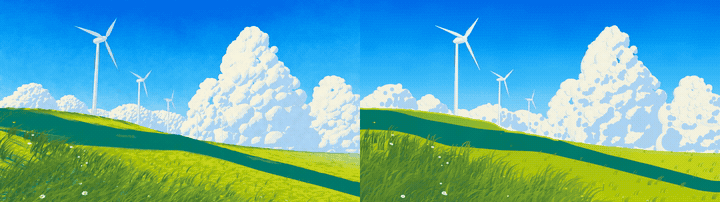
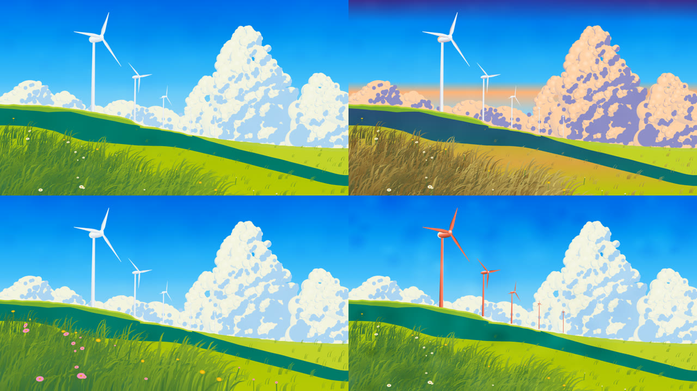
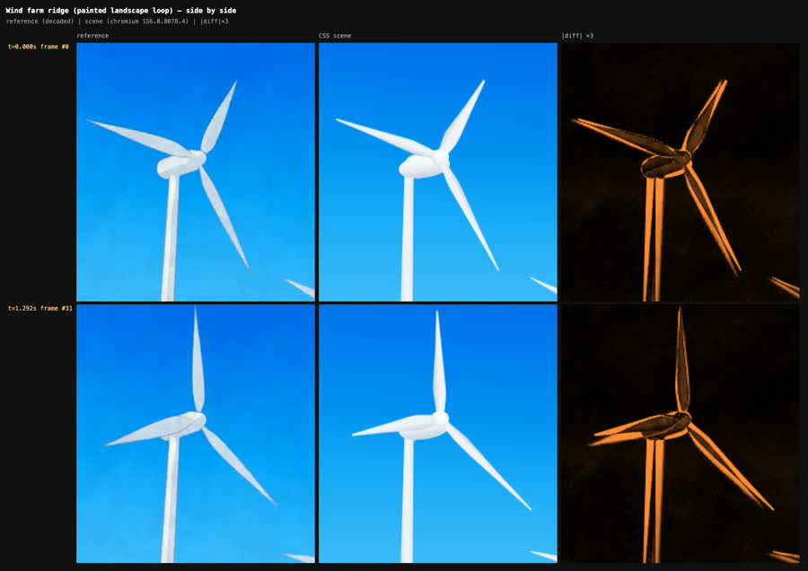
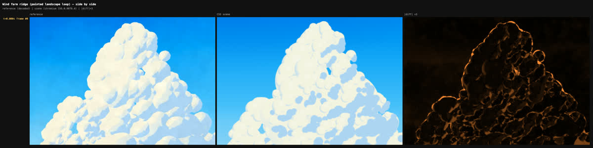
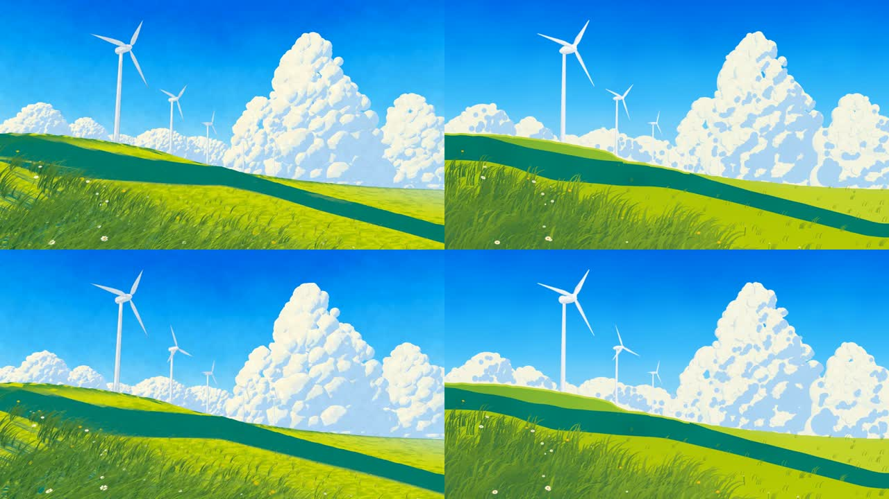

# Video to CSS

**Turn a reference video into an editable HTML/CSS animation.** A skill for coding agents (Claude Code, Codex,
Cursor, Copilot, Gemini) that rebuilds a clip as semantic DOM parts and CSS keyframes matched to the clip's real
timestamps, with runtime controls. A browser harness then reports what matches and what does not.

<p align="center"></p>

<p align="center"><sub>Left: the reference clip. Right: the CSS scene, captured at the same timestamps. No retiming.</sub></p>

**Wind Farm Ridge** ([`examples/wind-farm/`](examples/wind-farm/)) rebuilds a 10 s painted wind-farm loop
(1280×720, 24 fps): five turbines, a cumulus bank, a moving cloud shadow, wind in the grass, nodding flowers and
paper grain. The output is one `index.html` and one `scene.css`:

- 1,276 elements and 1,727 CSS animations.
- No images, video, canvas, SVG or JavaScript, and it plays with JavaScript disabled.
- 19 custom-property controls.

The scene is generated from seven part modules (`build/parts/*.mjs`). Each part was measured from the decoded
frames, and every number is labelled measured, estimated, chosen or fitted.

| One scene, different control values | Rotor at matched times (reference / CSS / difference) |
|---|---|
|  |  |
| Measured values; sunset palette; wind ×2 with taller grass and larger flowers; paper grain ×3 with recoloured turbines. All are custom properties on the root element. | The rotors are an affine `matrix()` plane solved from three measured blade tips, plus an inner `rotate()`. That reproduces the turbine's perspective tilt. |

| Cumulus at matched times | Full frame at matched times |
|---|---|
|  |  |
| 657 elements: lit lobes, shade patches packed on the measured shade mask, rims. Each cloud drifts on its measured path, about 6–10 px per loop. | Hills are `clip-path` polygons from column scans. The shadow band's edge is interpolated keyframes fitted to the clip. |

### How close is it?

There is no single "% similarity": appearance and timing are different questions, so they are reported
separately. Full numbers are in [`docs/EVIDENCE.md`](docs/EVIDENCE.md).

| | measure | result |
|---|---|---|
| Appearance | median / p95 colour difference per cell (ΔE, 16×9 grid, averaged over all 240 frames) | **2.48 / 8.08** (gates 4 / 10): pass |
| | cells within ΔE 10 | 96.5 % |
| | edge-layout correlation | 0.90 |
| | SSIM (reported, not gated) | 0.66, held down by the painterly texture |
| Timing | turbine phase error / speed error | ≤ 0.008 s / ≤ 0.5 % |
| | flowers, cloud-shadow edge | phase error 0.017 s |
| | motion energy | **fails**: the clip's thin grass strokes shimmer 1–2 px every frame; the broader CSS blades produce 0.38× as much frame-to-frame change |
| Structure | strict audit (DOM, CSSOM, computed styles, network, no-JS playback, reduced motion) | pass |
| Editability | 19 controls, each changing the render; several instances and other scenes on one page | pass |

Brush texture is approximated by gradient grain, not reproduced. Live playback in headless Chromium runs at about
30 fps; it has not been measured on a real display.

The reference is a Blender render of a still anime painting, made in the author's Video2Nodes project. It is not
AI-generated footage and not an independent benchmark. The clip itself is not in the repository; its SHA-256 is
in [`examples/wind-farm/REFERENCE.md`](examples/wind-farm/REFERENCE.md).

## Why

Asked to "make this clip in CSS", an agent works blind. It cannot see the browser, and a CSS file that loads can
still be wrong in ways nobody notices:

- timing taken from `frame / fps`, which drifts on variable-frame-rate clips;
- a rotated phone video built sideways, or a non-square-pixel video stretched;
- motion that looks right in one screenshot but runs late, fast or with the wrong easing;
- a check that captures the scene while it is still animating, or with animations disabled;
- the video or its frames hidden inside the "CSS" scene;
- a "% similarity" that hides a failing timing check behind a good colour match.

This toolkit closes those gaps:

- **Any input.** `v2css init` reads anything ffmpeg can decode (mp4, mov, webm, gif; any size, aspect,
  rotation or frame rate). It works at the size a player shows, finds the real timestamp of every frame, and
  guesses loop or one-shot from the seam. Pick a window of a longer clip with `--start/--duration`.
- **Deterministic seeking.** Scene time *t* means every CSS animation paused at `currentTime = t`. Screenshots
  are pixel-identical across runs and orders, and seeking matches hand-computed CSS timing to within 0.26 px in
  Chromium and WebKit.
- **Separate reports.** Appearance (per-cell colour, edge layout), timing (per-part trajectories, phase, rate
  and easing shape from noise-aware lag analysis, region brightness, motion energy, loop seam), structure (a
  strict audit) and editability (controls, embedding). They are never merged into one score.
- **Checks that are checked.** Six deliberately broken copies of every scene (frozen, shuffled, 0.4 s late,
  1.25× fast, a misplaced layer, linear easing) must each fail the check aimed at them. Each animation is also
  shifted 0.1 s, one at a time, to show which motions the probes actually observe.
- **A strict output profile.** No ` <video> <canvas> <svg> <script>`, no `url()`. Selectors, keyframes and
  custom properties are namespaced, so scenes can share a page. There is a reduced-motion pose.

## Install

**Claude Code** (plugin marketplace):

```bash
claude plugin marketplace add gokayfem/video-to-css
```

```bash
claude plugin install video-to-css@video-to-css
```

Or copy the skill: `cp -R skills/video-to-css ~/.claude/skills/`.

**Codex, Cursor, Gemini CLI, Copilot and other agents** (via [skills](https://github.com/vercel-labs/skills)):

```bash
npx skills add gokayfem/video-to-css
```

Or install by hand:

- **Codex:** copy `skills/video-to-css` to `~/.agents/skills/`.
- **Cursor:** copy it to `~/.cursor/skills/`.
- **Gemini CLI:** `gemini extensions install https://github.com/gokayfem/video-to-css`.

The toolkit needs Node 20 or later and `ffmpeg`/`ffprobe` on PATH. Install its two pinned dependencies
(Playwright and pngjs) and a browser once:

```bash
cd skills/video-to-css/scripts && npm install && npx playwright install chromium
```

## Use

Ask naturally, for example:

- *"Rebuild this loop in CSS: `hero.mp4`."*
- *"Make an editable CSS version of seconds 4 to 12 of this screen recording."*
- *"Match this GIF's timing in CSS keyframes and prove it."*
- *"Check my CSS animation against the reference clip."*

The agent scaffolds a scene package, builds parts in CSS, compares after every step, and runs the full check:

```bash
node v2css.mjs init clip.mov --out my-scene --start 4 --duration 8
node v2css.mjs sbs my-scene --times 0,2,4 --crop 300,120,240,160 --zoom 3
node v2css.mjs check my-scene
```

What the commands do:

- `init` writes `scene.json` (stage size = display size, time window, loop guess), a starter `scene/` that
  already passes the strict audit, `params.json`, a `REFERENCE.md` with the clip facts, and a contact sheet.
- `sbs` renders reference | scene | difference at chosen times, cropped and zoomed. It is the quick visual loop.
- `check` runs the audit, compares at every reference frame, runs the broken copies and the per-animation
  sweep, tests the controls and embedding, and writes `artifacts/<id>/SUMMARY.md` and a review page. The review
  page scrubs the reference and the live scene on one clock.

Other commands: `inspect`, `extract`, `capture`, `compare`, `negatives`, `audit`, `variants`, `perf`, `review`
([`references/harness.md`](skills/video-to-css/references/harness.md)).

## What fits strict CSS

Strict CSS handles these well:

- graphic and UI loops;
- layered illustration with parallax and occlusion;
- rotating and orbiting parts;
- CSS 3D boxes and cards;
- painted landscapes built from many simple shapes, like the wind farm.

It handles these poorly: brush and photographic texture, fluids, hair, faces and crowds. The skill says so
instead of hiding a video in the scene ([`docs/SCOPE.md`](docs/SCOPE.md)).

## Verification

| Check | Where | What it proves |
|---|---|---|
| Seeking | `tests/seek.test.mjs` | paused-`currentTime` seeking matches hand-computed CSS timing (delays, negative delays, `alternate`, `steps()`, cubic-bezier, pseudo-elements, fill) within 0.26 px in Chromium and WebKit; captures are order-independent |
| Any input | `tests/any-video.test.mjs` | rotated, non-square-pixel, GIF and WebM clips are read at display size with correct timestamps and loop guesses; a scene for a rotated portrait clip, in a folder outside this repo, passes all four outcomes and catches the broken copies |
| Video timing | `tests/video.test.mjs` | variable-frame-rate lookup by timestamp, colour decoding |
| Strict audit | `tests/audit.test.mjs` | planted violations (svg, canvas, script, `url(data:)`, unnamespaced keyframes, missing reduced motion…) are rejected |
| Broken copies | `tests/controls.test.mjs` | on calibration scenes built from synthetic clips, every kind of broken copy is caught, and none whose error exceeds the smallest gate is missed |
| Embedding | `tests/embed.test.mjs` | every control changes the render; instances and different scenes on one page do not interfere |
| Skill effect | `evals/` | with-skill vs without-skill authoring protocol (written, **not run yet**) |

CI (`.github/workflows/checks.yml`) runs the tests on Linux with Chromium and WebKit. Gates are declared in
`scripts/lib/compare.mjs` and never relaxed to make a case pass. Every check added after a failure is logged in
[`docs/EVIDENCE.md`](docs/EVIDENCE.md), along with known gaps. For example, a 0.1–0.3 s shift of a small pulsing
size animation is still not detected. Firefox could not be launched on the development machine, so it has no
coverage.

## Repository

```text
skills/video-to-css/     the skill: SKILL.md, references/, templates/, scripts/ (v2css CLI + harness)
examples/wind-farm/      the worked reconstruction: build/parts/*.mjs -> scene/, notes, parameters
prompts/                 reference-to-css prompt, part contract, visual review, delivery checklist
tests/                   harness tests, calibration scenes and fixtures
evals/                   with/without-skill protocol and cases
docs/                    contracts, architecture, scope, evidence
.claude-plugin/          Claude Code plugin + marketplace manifests
```

Contributing: see [AGENTS.md](AGENTS.md). Sibling projects:

- [shader-skills](https://github.com/gokayfem/shader-skills) (GLSL)
- [video-to-blender](https://github.com/gokayfem/video-to-blender) (Blender nodes)
- [video-to-physics](https://github.com/gokayfem/video-to-physics) (verified physics)

## Credits and license

MIT. All code is original. The ideas and sources it draws on are listed in [CREDITS.md](CREDITS.md).
